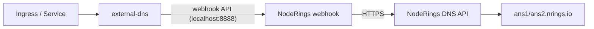

# external-dns-noderings-webhook

[](https://github.com/noderings/external-dns-noderings-webhook/actions/workflows/ci.yml)
[](https://github.com/noderings/external-dns-noderings-webhook/releases)
[](https://kubernetes-sigs.github.io/external-dns/)
[](LICENSE)

An [ExternalDNS](https://kubernetes-sigs.github.io/external-dns/) webhook provider for
[NodeRings DNS](https://noderings.com). ExternalDNS watches your Ingresses, Services and
Gateway routes and keeps matching DNS records in NodeRings DNS: create an Ingress for
`web.example.com` and the A record appears; delete it and the record goes away.

The webhook runs as a sidecar next to external-dns, installed with the official
external-dns Helm chart. You do not need a fork of external-dns or a separate chart.



## Before you start

- A Kubernetes cluster and Helm 3.
- A zone hosted in NodeRings DNS (**DNS → Add zone** in the NodeRings console). For the
  records to work on the internet, point the domain's nameservers at the ones NodeRings
  shows for the zone.
- A NodeRings service account token that can manage DNS records in that zone
  (**Settings → Service accounts**).

## Install

1. Store the token in a Secret:

   ```sh
   kubectl create namespace external-dns
   kubectl -n external-dns create secret generic noderings-token --from-literal=token=<TOKEN>
   ```

2. Save [`examples/values.yaml`](examples/values.yaml), change `example.com` to your zone
   in both places, and install the official chart:

   ```sh
   helm repo add external-dns https://kubernetes-sigs.github.io/external-dns/
   helm upgrade --install external-dns external-dns/external-dns -n external-dns -f values.yaml
   ```

3. Annotate an Ingress or a `LoadBalancer` Service with the name it should get:

   ```yaml
   apiVersion: networking.k8s.io/v1
   kind: Ingress
   metadata:
     name: web
     annotations:
       external-dns.kubernetes.io/ttl: "300"
   spec:
     rules:
       - host: web.example.com
         http:
           paths:
             - path: /
               pathType: Prefix
               backend: {service: {name: web, port: {number: 80}}}
   ```

   Within a minute, `web.example.com` points at the Ingress's address. external-dns also
   writes TXT records (`a-web.example.com`) that mark the record as its own, so it never
   changes records it did not create.

Check it:

```sh
dig +short web.example.com @ans1.nrings.io
kubectl -n external-dns logs deploy/external-dns -c webhook
```

> external-dns v0.24 reads annotations under `external-dns.kubernetes.io/`. The older
> `external-dns.alpha.kubernetes.io/` prefix is ignored unless you start external-dns with
> `--enable-legacy-annotation-prefix`.

## Configuration

The webhook is configured with environment variables on its container
(`provider.webhook.env` in the chart values).

| Variable | Default | Meaning |
|---|---|---|
| `NODERINGS_TOKEN` | (required) | Service account token. Fill it from a Secret. |
| `NODERINGS_TOKEN_FILE` | | Read the token from this file instead, for example a mounted Secret. |
| `NODERINGS_ORGANIZATION_ID` | | Organization to act in, for tokens that reach several. |
| `NODERINGS_API_URL` | `https://api.noderings.com` | API endpoint. |
| `DOMAIN_FILTER` | (all zones) | Comma-separated zones or names to manage. Keep it the same as external-dns's `domainFilters`. |
| `EXCLUDE_DOMAINS` | | Comma-separated names to leave alone. |
| `DEFAULT_TTL` | `300` | TTL in seconds for records without a `ttl` annotation. |
| `DRY_RUN` | `false` | Log the changes but do not make them. |
| `WEBHOOK_ADDRESS` | `localhost:8888` | Address of the webhook API. Keep it on localhost: external-dns runs in the same pod. |
| `HEALTH_ADDRESS` | `:8080` | Address of `/healthz` and `/readyz`, used by the chart's probes. |
| `LOG_LEVEL` | `info` | `debug` logs every API request (never the token). |
| `LOG_FORMAT` | `text` | `json` for structured logs. |

The webhook checks the token and lists the zones it will manage when it starts, and exits
with a clear message if the token is wrong.

## How records map

NodeRings stores a record set per name and type, with one or more values. That is the same
shape as an external-dns endpoint, so one endpoint is one NodeRings record set.

| | |
|---|---|
| Record types | A, AAAA, CNAME, TXT, MX, SRV, NS (below the apex), CAA, PTR, NAPTR. external-dns manages A, AAAA and CNAME unless you add types with `--managed-record-types`. |
| Zone apex | Supported (`example.com` itself). The apex SOA and NS records belong to NodeRings and are never changed. |
| Nested zones | A name goes to the longest matching zone, so `api.dev.example.com` lands in `dev.example.com` if you host both. |
| TTL | From the `external-dns.kubernetes.io/ttl` annotation, otherwise `DEFAULT_TTL`. |
| Set identifiers | Not supported (NodeRings DNS has no weighted or latency routing); such endpoints are skipped with a warning. |
| Failures | A record the API rejects is logged and reported to external-dns; the rest of the change still goes through, and external-dns retries on its next run. |

## Several clusters, one zone

Give each cluster its own `txtOwnerId`. Each external-dns then only changes the records
its own TXT records mark, and leaves the others alone.

## Troubleshooting

| Symptom | Check |
|---|---|
| Webhook exits with "the NodeRings API rejected the token" | The Secret holds the wrong token, or the service account was deleted. |
| "All records are already up to date" but nothing appears | external-dns found no endpoints: check the annotation prefix (see above), `domainFilters`, and that the Ingress or Service has an address. |
| "no managed NodeRings zone for endpoint" in the webhook log | The name is outside every zone the token can see, or outside `DOMAIN_FILTER`. |
| Records exist in NodeRings but do not resolve on the internet | The domain's nameservers at the registrar do not point at NodeRings yet. Query `ans1.nrings.io` directly to confirm the records are there. |

Set `LOG_LEVEL=debug` on the webhook to see every API call.

## Development

```sh
make test    # unit tests, including external-dns's own planner and TXT registry against an in-memory API
make lint    # golangci-lint
make image   # container image
NODERINGS_TOKEN=... hack/e2e.sh   # kind + official chart + the real API (creates and deletes a test zone)
```

The NodeRings DNS client in `internal/nrdns` is shared with
[cert-manager-webhook-noderings](https://github.com/noderings/cert-manager-webhook-noderings);
fixes there should land in both repositories.

## Related

- [cert-manager-webhook-noderings](https://github.com/noderings/cert-manager-webhook-noderings):
  TLS certificates for the same zones with ACME DNS-01.
- [Terraform provider](https://github.com/noderings/terraform-provider-noderings) and
  [Pulumi provider](https://github.com/noderings/pulumi-noderings) to create the zones.
- [Go SDK](https://github.com/noderings/noderings-go): official Go client for the NodeRings API.

## License

[Apache-2.0](LICENSE)
